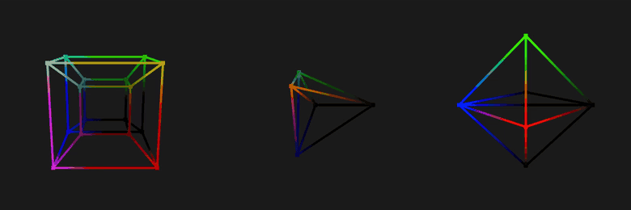

# N-Dimensional Projection Visualizer

[](https://github.com/lukajk1/n-dimensional-projection-visualizer/actions/workflows/build.yml)

Real-time OpenGL renderer for regular polytopes in 2 to 8 dimensions. Each shape rotates in planes of
its native space and is perspective-projected down to 3D, one axis at a time, then drawn with an
orbiting 3D camera.



*Left to right: 4D hypercube (tesseract), 5D simplex, 6D cross-polytope.*

## What it renders

| Family | Vertices | Edges | Built from |
| --- | --- | --- | --- |
| Hypercube | 2<sup>n</sup> | n·2<sup>n-1</sup> | every combination of ±1 |
| Simplex | n+1 | n(n+1)/2 | standard basis of R<sup>n+1</sup> expressed in the Helmert basis of its hyperplane |
| Cross-polytope | 2n | 2n(n-1) | ±1 on each axis, joined to all but its opposite |

All geometry is generated in C++ at startup ([src/polytopes.cpp](src/polytopes.cpp)).

## How it works

1. **Rotation.** Each dimension has a set of rotation planes, such as YW or XV, each with its own
   angular speed. The N×N rotation matrix is built by composing one rotation per plane
   ([include/rotation.h](include/rotation.h)). Rotating in a plane only mixes two rows, so each
   plane costs O(N).
2. **Projection.** The vertex shader ([shaders/ndim.v](shaders/ndim.v)) multiplies each vertex by
   the rotation matrix. It then repeatedly divides the remaining coordinates by the distance along
   the last axis, N → N-1 → … → 3. This is the same perspective divide used for 3D depth, applied
   once per extra dimension. One shader handles every dimension through a `dimensions` uniform.
   Coordinates are passed in as two `vec4` attributes.
3. **Display.** The resulting 3D points go through an ordinary view and projection matrix. Colour
   comes from the projected world-space position.

## Building

Requires CMake 3.20+, a C++17 compiler and OpenGL 3.3. GLFW and GLM are downloaded by CMake on the
first configure. glad and Dear ImGui are vendored.

```sh
cmake -S . -B build
cmake --build build --config Release
ctest --test-dir build -C Release
```

On Linux, install the X11 and OpenGL headers first:

```sh
sudo apt-get install libgl-dev libx11-dev libxrandr-dev libxinerama-dev libxcursor-dev libxi-dev
```

## Running

Run from the repository root or from the build output folder; shaders are copied next to the
executable.

```sh
build/Release/ndim-projector                    # Windows (Visual Studio generator)
build/ndim-projector --shape simplex --dim 6    # Linux / single-config generators
```

The side panel switches family and dimension and adjusts time speed, zoom, edge thickness and
vertex size. The scroll wheel also zooms.

### Recording

`--capture DIR --frames N` renders N frames at a fixed 30 fps time step without the UI. It writes
them to DIR as PPM images, then exits. The frames for the GIF above were captured this way:

```sh
build/Release/ndim-projector --shape hypercube --dim 4 --capture frames --frames 210
ffmpeg -framerate 30 -i frames/frame_%04d.ppm -vf "crop=720:720:280:0,scale=260:260" out.mp4
```

## Project layout

```
main.cpp                 window, render loop, UI, command line, frame capture
include/polytopes.h      hypercube / simplex / cross-polytope generation (no OpenGL)
include/rotation.h       N-dimensional rotation matrix from rotation planes (no OpenGL)
include/ndim_object.h    GPU buffers and draw call for one polytope
src/shape_catalog.cpp    rotation planes and scale for each family and dimension
shaders/ndim.v           N-dimensional rotation and projection
tests/geometry_tests.cpp edge counts, edge lengths, centring and rotation orthogonality
```
